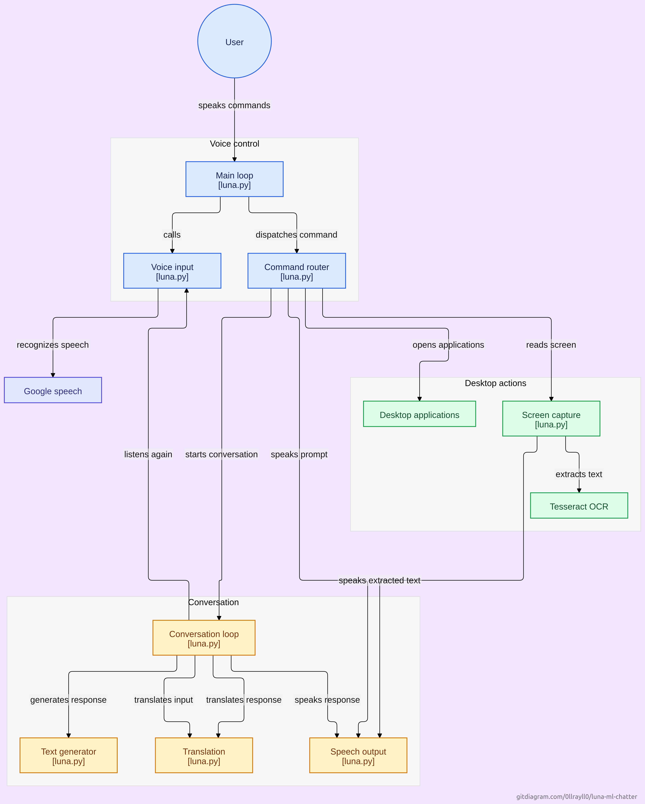

# Luna - IA Assistente Virtual por Voz

A **Luna** é uma assistente virtual inteligente operada por comandos de voz e ações de desktop. A aplicação é capaz de reconhecer voz, traduzir textos, ler a ecrã através de OCR e interagir de forma conversacional gerando respostas dinâmicas.

##  Arquitetura do Sistema

O diagrama abaixo ilustra o fluxo de processamento e os módulos que compõem a **Luna**:



---

##  Como Funciona a Arquitetura

O sistema é dividido em três blocos principais geridos pelo módulo central (`luna.py`):

### 1. Controllo de Voz (Voice Control)
* **Main Loop:** Ciclo principal que recebe os comandos de voz do utilizador.
* **Voice Input:** Captura a fala do utilizador e utiliza o **Google Speech** para fazer o reconhecimento de voz (*Speech-to-Text*).
* **Command Router:** Encaminha a instrução reconhecida para a ação adequada (conversação ou ações no sistema).

### 2. Ações de Desktop (Desktop Actions)
* **Desktop Applications:** Abre e interage com aplicações do sistema operativo.
* **Screen Capture & Tesseract OCR:** Captura a ecrã e utiliza o motor **Tesseract OCR** para extrair texto de imagens da ecrã. O texto extraído é depois transmitido por voz para o utilizador.

### 3. Módulo de Conversação (Conversation)
* **Conversation Loop:** Gerencia o fluxo de diálogo.
* **Text Generator:** Gera respostas inteligentes para as perguntas e comandos do utilizador.
* **Translation:** Traduz as entradas do utilizador e as respostas geradas quando necessário.
* **Speech Output:** Converte o texto final em fala (*Text-to-Speech*) para responder ao utilizador.

---

##  Requisitos e Tecnologias

* **Linguagem:** Python 3.x
* **Reconhecimento de Voz:** Google Speech API / SpeechRecognition
* **Visão Computacional & OCR:** Tesseract OCR, PyTesseract, Pillow/PyAutoGUI
* **Síntese de Voz (TTS):** pyttsx3 / gTTS
* **Ficheiro Principal:** `luna.py`

---

## 💻 Como Executar

1. **Clona o repositório:**
   ```bash
   git clone https://github.com/teu-usuario/luna-ai.git
   cd luna-ai
   ```

2. **Instala as dependências:**
   ```bash
   pip install -r requirements.txt
   ```

3. **Executa a Luna:**
   ```bash
   python luna.py
   ```

---

*Desenvolvido por [Raul](https://github.com/teu-usuario)*
